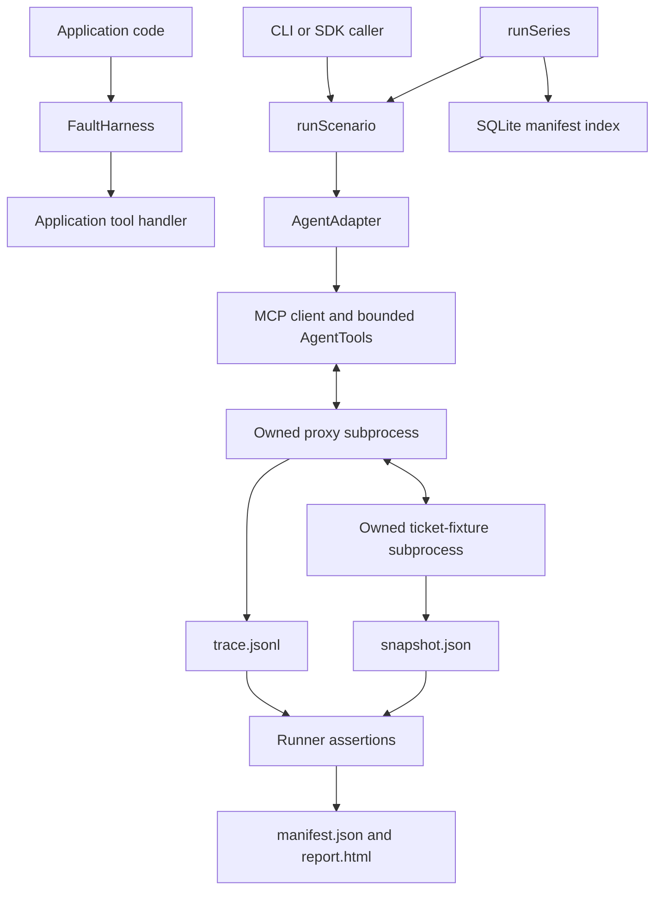

# ToolChaos architecture

[← Project overview](../README.md) · [Usage guide](usage.md)

This describes the implemented 0.2.0 system. ToolChaos has a reusable fault-injection layer and a concrete evaluation runner for the bundled ticket fixture. The runner is deliberately narrower than a general agent benchmark platform.

## HLD: processes and data flow



The scenario runner owns subprocess startup, MCP discovery, call limits, cancellation, shutdown, and artifact collection. The proxy changes only selected `tools/call` exchanges; MCP negotiation, notifications, and unrelated traffic pass through. The fixture owns the effect being measured.

A normal scenario runs locally in three processes: the runner, proxy, and fixture. The optional model adapter adds outbound provider requests from the runner process. Neither the model nor the proxy supplies the final pass/fail decision.

## LLD: contracts and responsibilities

| Module | Contract | State it owns |
| --- | --- | --- |
| [`index.ts`](../src/index.ts) | `FaultHarness(handler, rules)`; `call(tool, args)` | Per-tool occurrence counts, request IDs, and event metadata |
| [`proxy.ts`](../src/proxy.ts) | `runProxy(config, command): Promise<number>` | Pending requests, fault occurrences, trace stream, owned process group |
| [`agent.ts`](../src/agent.ts) | `AgentAdapter.run(tools, task, signal)` | Strategy or provider conversation state |
| [`runner.ts`](../src/runner.ts) | `runScenario(scenario, agent, output, {signal})` | Run deadline, call count, assertions, manifest |
| [`fixture.ts`](../src/fixture.ts) | MCP `create_ticket` / `find_ticket` | Synthetic tickets and operation-key identity |
| [`history.ts`](../src/history.ts) | `runSeries(...)`; `RunStore.record/list/close` | Series summary and manifest lookup metadata |
| [`cli.ts`](../src/cli.ts) | Argument parsing and concrete adapter construction | No separate domain policy |

### Fault contract

A rule is `{tool, occurrence, fault}`. Occurrences start at 1 for each tool. Duplicate tool/occurrence rules are rejected instead of competing at runtime.

| Fault | SDK behavior | Proxy behavior |
| --- | --- | --- |
| `error_before_forward` | Throws before invoking the handler | Returns an injected JSON-RPC error without forwarding |
| `drop_response_after_forward` | Invokes the handler, then throws `FaultError` | Forwards the request, then withholds its response |
| `replace_response` | Returns `{malformed: true}` after invocation | Replaces the response result with that payload |

The SDK represents the ambiguous outcome; it does not simulate elapsed request-timeout duration. Use the proxy when the client must experience an actual missing response. Its `timeoutMs` is the lifetime of the proxy session, not a per-request timeout.

### Agent contract

```ts
interface AgentAdapter {
  name: string;
  metadata: Record<string, unknown>;
  run(tools: AgentTools, task: string, signal: AbortSignal): Promise<void>;
}
```

`AgentTools` contains only `list()` and `call(name, args)`. The runner constructs this narrow interface from discovered MCP tools and enforces the call count and call timeout. An adapter must honor the abort signal; arbitrary custom in-process code cannot be forcibly sandboxed by this contract.

`ReferenceAgent` supplies `naive`, `idempotent`, and `reconcile` strategies. `AnthropicAgent` supplies a bounded Messages tool-use loop. Adding a different model adapter does not require changing deterministic assertions. The current runner still assumes the bundled ticket fixture; support for another domain would require a deliberate runner/fixture extension.

## One request, from failure to evidence

1. `runScenario` validates the scenario, limits, and fault rules, then creates a new output directory exclusively.
2. It starts the proxy and fixture through an MCP stdio transport and discovers the tool schemas.
3. The agent calls `create_ticket`. The fixture creates `T1` and atomically replaces its snapshot file.
4. The proxy records the committed upstream response but drops it according to the configured occurrence.
5. The client times out. The reconciliation agent calls `find_ticket` with the same operation key and finds the existing ticket.
6. The runner closes the transport, reads the fixture snapshot and trace, checks ticket count/call bounds, and verifies that every configured fault was exercised.
7. It writes a manifest and escaped HTML report. A run series separately indexes the manifest hash and path in SQLite.

The fixture serializes its request handlers. Reusing an operation key with the same title returns the original ticket; changing the title under that key returns an error. These rules make duplicate effects observable without a real external account.

## Verdicts and failure semantics

| Result | Meaning |
| --- | --- |
| `PASS` | Execution completed, every fault was exercised, and all recorded assertions passed |
| `FAIL` | Execution completed and exercised the faults, but a recorded assertion failed |
| `INCONCLUSIVE` | Cancellation, missing evidence, infrastructure failure, or an unexercised fault prevented a complete result |

The concrete assertions are expected ticket count and bounded tool calls. They do not establish every possible semantic property of a ticket workflow. An agent's prose is never an assertion input.

Overall run time and per-call time are separate bounds. The call timeout must be shorter than the run timeout. The proxy receives an additional cleanup window. POSIX shutdown sends signals to the owned process group, including descendants that remain in it; deliberately escaped processes require an OS sandbox. Windows process-tree cleanup is not claimed.

## Persistence and reproducibility

Each new run directory contains `proxy.json`, `trace.jsonl`, `snapshot.json`, `manifest.json`, and `report.html`. Existing run directories are rejected. The manifest records configuration hash, runtime, tool schemas, adapter metadata, assertions, events, and final fixture state.

Traces store IDs, tool names, occurrence numbers, and stages rather than raw tool arguments or responses. Snapshots and manifests still contain synthetic task data; custom adapter metadata is copied verbatim and must not contain credentials.

`runSeries` creates a fresh adapter and fixture for every run. `runs.sqlite` stores manifest references and SHA-256 hashes under schema 1; the artifacts remain the detailed evidence. Preserve the database and run directories together. Unknown index schemas are rejected rather than migrated implicitly. Pass fractions describe only the executed sample.

## Design choices and tradeoffs

- **Separate responsibilities:** the fixture owns effects, the proxy owns protocol faults, the runner owns evaluation, and the index owns lookup metadata.
- **Composition over a framework hierarchy:** model behavior varies behind `AgentAdapter`; function-level injection takes an ordinary callback. No shared service or inheritance tree is needed.
- **Behavioral substitution:** every agent adapter receives the same bounded tools and must respect cancellation. Tests cover the native adapter protocol, while live model quality remains separate.
- **Small interfaces:** agent code can list and call tools, but cannot change assertions or directly read ground-truth files through the supplied interface.
- **Concrete local storage:** JSON evidence and SQLite metadata make runs easy to inspect. They are not a distributed job queue or an immutable remote audit service.

The code's public exports and runner are coupled through `index.ts`; this is a small package, not a claim of perfectly isolated layers. Introducing another fixture domain would be the point to extract a dedicated evaluator contract, not a reason to add one speculatively now.

## LLM boundary

A model can choose tools and arguments. It cannot decide the verdict, edit the scenario's expected state, or convert missing evidence into success. The optional native adapter validates tool-use structure, bounds turns and output tokens, and rejects redirects on credential-bearing requests.

Provider calls are opt-in and send the task and selected tool results to that provider. The default demonstrations use reference strategies and no model calls. A local protocol test does not validate a model's recovery quality.

## Verification and extension points

See [`test/`](../test) for fault semantics, exact occurrence coverage, protocol forwarding, cancellation, process cleanup, recorded evidence, and repeated-run isolation. Reproduce the checks with `npm run typecheck`, `npm run build`, and `npm test` from the repository root.

Start an integration by choosing the smallest boundary: a `FaultHarness` for an existing function, the proxy for an existing test MCP server, or `AgentAdapter` for the supplied ticket scenario. See the [usage guide](usage.md), [scenario schema](../schemas/scenario.schema.json), and [security boundaries](../SECURITY.md).
